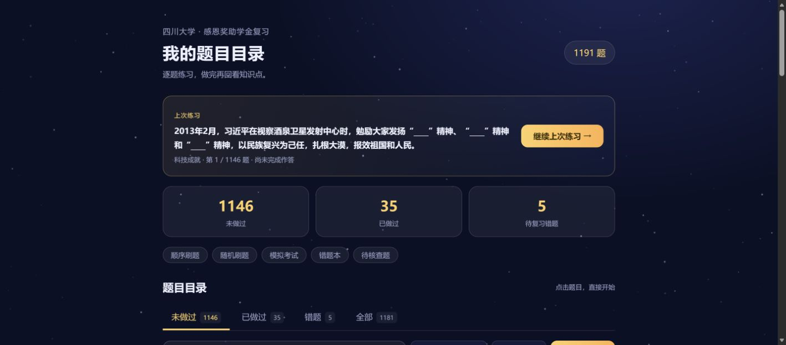
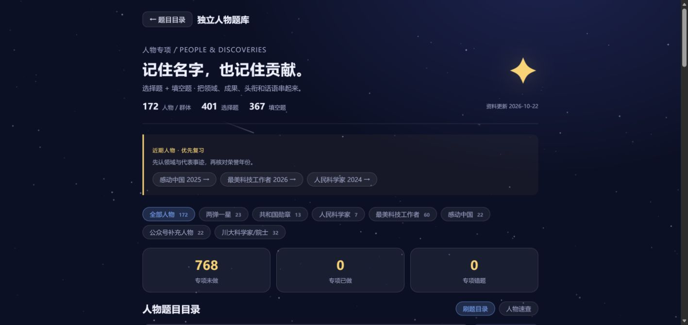
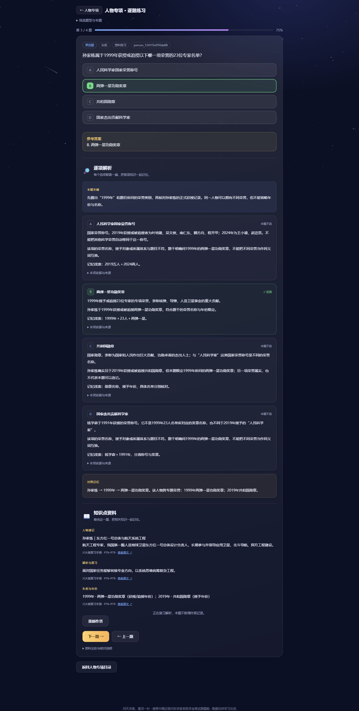
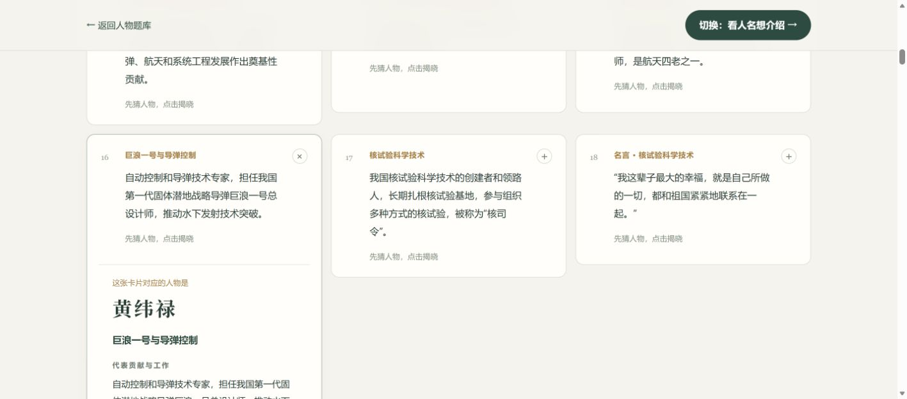

# 问天刷题舱 四川大学扩充版

感恩中国近现代科学家奖助学金复习题库。根据四份上传资料扩充，在原项目140题基础上当前提供 **1151题**，其中**186题为川大校情**；另有40条川大人物旧题按新范围归档，**10题待核查**单列。

[立即刷题](https://Jinlin-Yao.github.io/ganen-scientist-quiz/) · [资料覆盖](docs/COVERAGE.md) · [勘误与时效说明](docs/CORRECTIONS.md)

新增独立的 [科学家人物专项](https://jinlin-yao.github.io/ganen-scientist-quiz/#people)：**161个人物/群体、724题（378选择＋346填空）**，按领域、成果、头衔、名言复习。涵盖两弹一星23人、人民科学家7人、全国最美科技工作者60人、共和国勋章13人全名单，以及川大、公众号补充人物。“感动中国”选收2021—2025年度科研等相关人物，非科研仅保留苏炳添、郑钦文两位知名代表。[人物范围与出处](docs/PEOPLE.md)。专题人数有交叉。

人物专项支持专题、荣誉年份、人物与考点筛选，另有“人物速查”。原题库和人物专项分别保存草稿、作答位置和随机练习顺序；通用题库与模拟考试保持独立。

两套题库共 **462道选择/判断题、1828个选项** 均有逐项解析：本题关键、每项人物/概念说明、应选或排除理由、来源及对照记忆。选择后自动展开全部选项解析；模拟卷交卷后也可查看。点击“查看解析（不计分）”可直接复习，不新增作答或错题记录，想作答时点“重新作答”。

新增 [人物记忆卡片](https://jinlin-yao.github.io/ganen-scientist-quiz/memory.html#names)：161张人名卡，点击才显示称号、领域、贡献、名言及出处；顶部按钮切换到174张关键词卡（161张工作与贡献卡＋13张名言卡），先看线索再揭晓人物。可按专题筛选、打乱顺序、收起全部答案，并分别记录两个方向的“记住了／还需复习”和上次卡片。关键词搜索仅查卡片正面，避免通过隐藏的人名提前得到提示；掌握标记不影响题库作答记录。


川大人物已按[学校人事处历代两院院士名录](https://rsc.scu.edu.cn/szdw/lyys.htm)收窄为**20位院士（中科院8位、工程院12位）**，包含已故院士；题库、速查与两面记忆卡片共用同一名单。该专题有68题、20张人名卡、21张反向卡。一般科学家、医学先贤以及不在该官网名录中的校友、双聘人物不再作为川大人物考点；其他荣誉专题单独保留，例如陈蕾仍在“最美科技工作者”中。









## 使用

首页为可点击的题目目录，按“未做过／已做过／错题／全部”分组，可按专题、题型和关键词筛选。每道题均配有作答后显示的知识点资料。

首页提供“继续上次练习”：同一浏览器刷新或关闭后重开，可恢复具体题目、练习顺序、已选选项、填空草稿及已显示的答案，不重复计分。旧版作答记录自动保留，无需账号或后端。填空支持规范答案、预设同义答案及原题关键词；可自评修正判分，避免合理答案因表达差异被误记。

- 单选与判断 67题，多选 17题，填空 496题，简答与记忆闪卡 571题。
- 主题包括两弹一星23人、人民科学家专题、2018及2019最美科技工作者、其他科学家、川大校史与学者、科技史、科技奖励、时政理论、科学家精神和论述面试。
- 每题保留文档、段落或原题编号。原项目题源标签保留在独立字段；新增练习不标成真题。
- 待核查题可查阅，无法计入掌握，不进入错题本和模拟卷。历史口径题与明确设为不宜考试的题也不参与模拟抽题。
- 模拟卷为练习配置：60分钟，20单选×2分＋5多选×4分＋10填空×2分＋2简答×10分＝100分。简答自评。川大2026年通知确认总评权重为基础40、笔试20、面试40；本软件不据此宣称官方笔试时长或题型配比。

## 练习记录与复习资料

- 点击目录中的任意题目可直接进入，完成后目录状态自动更新。
- 选择题、填空题完成提交后计为已做；简答闪卡在自评后计为已做。查看答案不会替代简答自评。
- “已做过”与“答对”不同，错题仍可单独筛选。未完成的草稿会恢复，但不会提前计为已做。
- 自评后停留在本题，便于阅读知识点，点击下一题再继续。
- 每题资料优先关联已有复习材料中的人物、成果、时间线与易混点；原资料未提供更多事实时，附上本题核心线索与专题复习方法，不编造人物事迹。
- 保存范围是当前浏览器、当前网站；不会自动跨设备同步，清除网站数据会失去本地记录。

## 资料

1. 感恩奖学金复习整合资料（资料+挖空试题）.docx
2. 感恩笔试真题_ELAN整理版.pdf
3. 感恩中国近现代科学家奖学金准备.docx
4. 感恩中国近现代科学家奖助学金笔试复习手册_四川大学版.docx

全部135道ELAN整理题与手册100道练习均已建立对应记录。重复知识合并或交叉引用；关键年份、领域、成果、精神表述另拆练习。源文件中的目录、排版说明、个人经历范例不作为事实题。原始文档未随仓库上传。

部分旧资料存在错误和失效信息，已修正可确认的问题，详见勘误。未取得可靠依据的10题仍待核查，不将其答案当作确定事实。资料覆盖不等于全部内容都已独立核验，也不构成对考试范围的保证。

## 本地运行与维护

直接打开 `index.html`，或在项目目录执行 `python3 -m http.server 8000` 后访问本地地址。网站为纯静态文件、无依赖。

完整数据源为 `data/bank.json`。标记 `studyExcluded` 的40条旧题仅留作源资料覆盖核对，不输出到网页题库、复习资料或模拟考试。`knowledge.js` 和 `data/knowledge.json` 为每题的复习资料，由已校正题库中的相关事实段落、易错提醒及专题背景整理，并保留来源。改题后执行：

```sh
node scripts/build.cjs
python3 scripts/build-knowledge.py
node scripts/test.cjs
node scripts/test-progress.cjs
python3 scripts/build-people.py
node scripts/test-people.cjs
python3 scripts/build-explanations.py
node scripts/test-explanations.cjs
python3 scripts/build-memory.py
node scripts/test-memory.cjs
node scripts/test-scu-scope.cjs
```

通用题输出到 `questions.js`，川大题输出到 `my-school.js`；保留 `school.example.js` 作为其他学校模板。题目ID稳定保存，追加新题请使用新的唯一ID。不要将旧题ID转用于其他题目，以免错题进度串题。

`data/coverage.json` 保存逐段对应关系；`data/source-catalog.json` 保存文档目录及手册原有官方参考链接；`data/corrections.json` 保存原项目结构化修订。修改时应同时维护相关记录。

逐项解析的数据源为 `data/option-explanations-source.json` 与已有人物资料；生成的 `data/option-explanations.json` 和 `explanations.js` 按稳定题目ID关联，选项顺序与正误标记有完整校验。人物干扰项说明各自真实领域，不将“本题不选”写成“此人没有科学贡献”；跨专题荣誉按具体名称与年份区别。修改题目或人物资料后，最后运行 `scripts/build-explanations.py` 重新生成解析。

记忆卡片是独立静态页面 `memory.html`，轻量数据 `memory-data.js` 由 `data/people.json` 和 `data/memory-additions.json` 生成。后者按川大、两院及研究机构官方介绍补充9位川大院士的详细工作与院士头衔。更新人物资料后同时运行 `scripts/build-memory.py`。两面用同一份人物介绍，反向卡片正面会隐藏已收录人物的姓名；名言卡附领域提示；荣誉年份随介绍显示，不把多人共有的荣誉单独设为唯一人物线索。

## 原项目与署名

本仓库Fork自 [jiazhaojune-gif/ganen-scientist-quiz](https://github.com/jiazhaojune-gif/ganen-scientist-quiz)，保留星空界面、原项目功能与来源历史。[原版说明](docs/UPSTREAM_README.md) 可回查。

原仓库未附明确的开源许可证，本版未替原作者添加许可证或改变其原有权利声明。题目与资料仅用于学习交流，与奖助学金主办方无隶属关系。

川大院士范围由 `data/scu-academicians.json` 固定记录官网来源、20人名单与退出练习的旧题ID；改动名单时须同时更新人物数据并运行全部生成和校验脚本。旧专题筛选自动迁移到新名称，仍在范围内的题目ID和学习记录继续保留。
